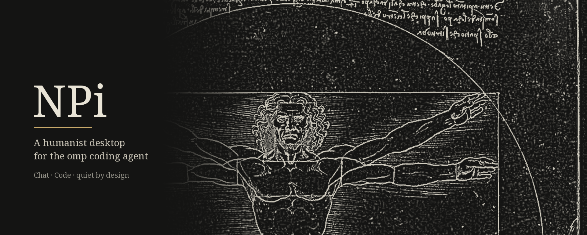
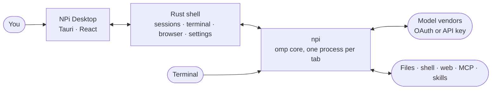

<p align="center">
  
</p>

<h1 align="center">NPi Desktop</h1>

<p align="center"><sub>NeoPi Desktop &nbsp;·&nbsp; 1.0.1 &nbsp;·&nbsp; for macOS on Apple silicon</sub></p>

<p align="center"><em>What a piece of work is a man! How noble in reason, how infinite in faculty!</em><br>
<sub>— William Shakespeare, <i>Hamlet</i>, II.ii</sub></p>

<p align="center">
  
  
  
  
  
  
  
  
  <a href="LICENSE"></a>
</p>

<p align="center"></p>

**NPi is an AI agent for people who think for a living** — a native Mac app and a
command line that read, write, research and build alongside you. It is made on
one conviction: *tools for thinking should feel like a study, not a cockpit.*

Five hundred years ago the Renaissance asked a question that software has since
forgotten: what does it look like when a tool is built to the measure of a
person? NPi answers it the way the studios of Florence did — with proportion,
with restraint, and with a craftsman's care for the parts nobody praises.
Underneath sits a modern engine: a Rust shell, a React interface, and the
[omp](https://github.com/can1357/oh-my-pi) agent over its native protocol.

<p align="center"></p>

## Firmitas · Utilitas · Venustas

> *Thou art more lovely and more temperate.*
> <br>— William Shakespeare, Sonnet 18

The Roman architect Vitruvius named three conditions of good building —
*firmitas, utilitas, venustas*: strength, usefulness, beauty. They are the three
promises of this product.

<table>
  <tr>
    <td width="33%" valign="top">
      <h3>Firmitas <sub>· sturdy</sub></h3>
      A native window, one process per conversation, sessions saved as plain files you
      own. Nothing phones home; nothing updates itself behind your back.
    </td>
    <td width="33%" valign="top">
      <h3>Utilitas <sub>· useful</sub></h3>
      Two rooms for two kinds of work, a model picker that knows your vendors, honest
      numbers for plan limits and spend, a terminal, a browser and subagents when
      you need them — and out of sight when you do not.
    </td>
    <td width="33%" valign="top">
      <h3>Venustas <sub>· beautiful</sub></h3>
      Six themes, a bundled serif, five levels of detail, and the faint engravings
      of the old masters behind the conversation. Calm by default, never loud.
    </td>
  </tr>
</table>

<p align="center"></p>

## Two rooms

<table>
  <tr>
    <td width="50%" valign="top">
      <h3>✦ Chat</h3>
      <em>For everything that is not code.</em><br><br>
      Writing, research, learning, planning, a question at midnight. Conversations
      are listed by day in a space of their own. Tell the assistant who you are and
      how you like to be answered; it keeps a memory on your computer and nowhere
      else.
    </td>
    <td width="50%" valign="top">
      <h3>✦ Code</h3>
      <em>For projects.</em><br><br>
      Open a folder and the agent reads, edits and runs inside it, under the
      approvals you choose. The side panel shows where you are — folder, branch —
      how full the context is, and how much of your plan you have used.
    </td>
  </tr>
</table>

Switching rooms always lands on that room's start page, greeted by the hour —
*Night owl, Kazuma* — or by a line of its own.

<p align="center"></p>

## The craft

> *Beauty is the reasoned harmony of all the parts, so that nothing may be added,
> taken away or altered, save for the worse.*
> <br>— Leon Battista Alberti, *De re aedificatoria*, VI (after the common English rendering)

| | |
|---|---|
| **A native window** | A translucent sidebar, one top bar, a centred reading column, a prompt box that is a single line until you need more. |
| **Themes & type** | Graphite, Ivory and the four Catppuccin flavours. Noto Sans and Noto Serif, bundled — Chinese included. |
| **Your measure** | Five levels of detail, from the barest window to the fullest, and three widths for the conversation. |
| **Models by vendor** | A small picker beside the prompt lists the models you ticked; the rest are one step away. Sign-in is omp's own OAuth. |
| **Honest numbers** | Plan limits as the share *used*; spend and tokens for the conversation; the context window split into its parts. |
| **Columns that open** | Terminal, browser and subagents appear at the right and leave when you close them. |
| **A tidy sidebar** | Right-click to pin, mark unread, rename, archive or delete; manage the archive in Settings. |
| **Small courtesies** | Hover tips that name a button and its shortcut; a turning hourglass that says whether the agent is loading, reasoning or writing. |

<p align="center"></p>

## How it fits together



| Layer | Made with |
|---|---|
| Shell | [Tauri 2](https://tauri.app): a native macOS window with a translucent sidebar |
| Back end | Rust: the agent bridge, saved sessions, terminal, browser and settings stores |
| Front end | React 19 as plain scripts, no bundler; Babel only while developing |
| Agent | omp 18.14 as `npi`, over its RPC protocol |
| Command line | TypeScript on Bun, compiled to a single binary |
| Look | Graphite · Ivory · Catppuccin; Noto; six public-domain engravings |

<p align="center"></p>

## Install

1. Open `NPi-Desktop-1.0.1-arm64.dmg` and drag **NPi Desktop** to *Applications*.
2. The app is not notarized, so the first time, right-click it and choose **Open**.
3. Sign in from **Settings → Models**, or from a terminal with `npi login`.

The command line travels inside the app. To use it in any terminal:

```bash
ln -sf "/Applications/NPi Desktop.app/Contents/MacOS/npi" ~/.local/bin/npi
npi --version        # npi/1.0.1
```

**Requires** macOS on Apple silicon.

<p align="center"></p>

## Where things live

> *Man is the measure of all things.* — Protagoras

Your things stay where you can see them.

| What | Where |
|---|---|
| Settings, sign-ins, conversations, caches | `~/.local/share/npi` |
| Your workspace, and the Chat folder | `~/Documents/NPi` |
| The Chat assistant's profile and instructions | the app's config folder |
| Project-local configuration | `.omp/` inside the project, as in omp |

NPi keeps to itself. Its data is separate from a stock omp install. There is no
remote access, no tracking, and no self-update that reaches for the network —
new versions arrive with new releases of the app.

<p align="center"></p>

## The command line

`npi` is omp, renamed and quieter, with the prompt on the bottom row from the
first frame. Its settings are tiered, so the list a person meets is short:

- **everyday** settings are always listed;
- **more** appear after *Show More Options*;
- **Advanced** holds the long tail — terminal tuning, memory systems, retries,
  providers.

Nothing is removed: a setting you do not see still reads from the config file.

<p align="center"></p>

## Build from source

```bash
# the app
cd desktop
npm install
npm test
npx tauri build --config src-tauri/tauri.dist.conf.json --bundles app,dmg

# the command line (an omp checkout on the `npi` branch, built with Bun)
cd ../omp
bun install && bun run build:native
cd packages/coding-agent && bun run build            # → dist/npi
cp dist/npi ../../../desktop/src-tauri/binaries/npi-aarch64-apple-darwin
```

The app and the command line share one version number. Raise it in
`desktop/src-tauri/tauri.conf.json` (with `Cargo.toml` and `package.json`) and in
`NPI_VERSION` in `omp/packages/utils/src/dirs.ts`, together.

```
desktop/    the Tauri app: React front end (no bundler), Rust back end
omp/        the command line — its own repository, branch npi; not part of this one
branding/   the logo and icon sources
docs/       this page's banner
dist/       release builds (not tracked)
```

<p align="center"></p>

## Known limits

- macOS on Apple silicon only, for now; the build is ad-hoc signed, not notarized.
- Chat is a mode of the same agent: it carries its own prompt and memory, but the
  agent still has its tools. Ask it before it touches your files.
- The command line's own test suite has not been brought up to the new name yet.

<p align="center"></p>

## License

NPi Desktop is open source under the **[MIT License](LICENSE)** — use it, change
it, share it, keep the notice. It stands on other open-source work, whose
licenses travel with it: see **[THIRD_PARTY_NOTICES.md](THIRD_PARTY_NOTICES.md)**
(omp and omp-desktop under MIT; Noto fonts under the
[SIL Open Font License](licenses/OFL-1.1.txt); Catppuccin under MIT; the Rust
crates listed in [docs/licenses](docs/licenses/rust-crates.md)).

<p align="center"></p>

## Thanks

> *Ars longa, vita brevis.* — Hippocrates, in Seneca's rendering

- **omp** by Mario Zechner and Stencil Labs, and **omp-desktop** by Miroslav
  Drbal — both MIT. NPi stands on their work; see `omp/LICENSE` and `desktop/LICENSE`.
- **Noto** fonts (SIL Open Font License) and **Catppuccin** (MIT).
- The engravings behind the conversation are in the public domain, from
  Wikimedia Commons; see `desktop/src/assets/wallpapers/CREDITS.md`. The banner
  is Leonardo's *Vitruvian Man*, c. 1490.

<p align="center">
  <sub>Made with proportion, in the spirit of those who measured the world by the human figure.</sub>
</p>
