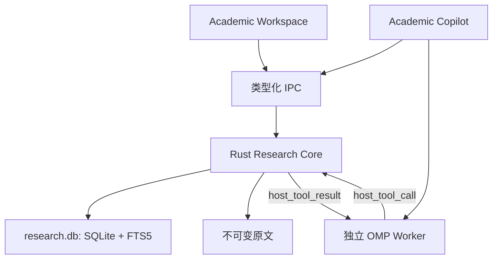

# NPi Renaissance 3.0 技术方案(精简版)

**核心思路:一个 Rust Research Core、两个入口、固定宿主工具。**

- **Academic Workspace**:组织项目、论文、摘要、证据与对照成果。
- **Academic Copilot**:可在 Chat / Code / Academic 中打开的独立侧栏,独立会话,不继承当前工作区的文件与上下文。
- **Rust Research Core**:数据、文件访问和成果写入的唯一权威。
- **OMP**:只复用 Agent 循环、模型适配、流式输出与上下文管理;Copilot 的读写一律经 Rust 宿主工具。

关键判断:**现有侧栏和 Runtime 可复用,但审批机制不等于权限隔离,仅配置工具名单也不够。**

本方案基于源码与官方文档调查,未修改代码、未构建、未实测解析器。"现状"指调查时的工作树,"建议"均为待实施设计。`docs/PLAN.md` 是旧规划,其中的科研 IR、本地 MCP、LaTeX 编译、快照均未实现,不沿用。

---

## 1. 可复用的现状

| 项 | 现状 | 用法 |
|---|---|---|
| Academic 模式 | `AppMode::Academic` 存在,但提示词仍继承 Code(`app_mode.rs:79–116`) | 只是壳,科研工作区需新建 |
| SideChat | 独立临时 worker、常驻侧栏,隐藏不销毁(`lib.rs:241–299`、`side-chat.jsx:17–37`) | Copilot 的 UI 与生命周期模板 |
| Host Tool RPC | OMP 已有 `set_host_tools` → `host_tool_call` → `host_tool_result`(`rpc-mode.ts`、`host-tools.ts`) | Copilot 工具的执行通道 |
| 文件安全 | 项目根校验、符号链接逃逸检查(`project_file.rs:81–123`) | 复用路径校验,不直接复用预览 API |
| PDF 提取 | `pdf-inspector` → Markdown,含页标记(`pi-natives/src/pdf.rs`) | MVP 基础解析 |
| SQLite | 已依赖 bundled `rusqlite`,已有 FTS5 用例 | 科研索引独立建库 |
| 上下文压缩 | 会话树、压缩与 token 预算 | 仅管"本轮带什么进模型",不承载论文成果 |

---

## 2. MVP 范围

**纳入**

1. Research Workspace:创建/打开项目;导入文献与解析状态;章节树;原文 / 章节摘要 / 总摘要三级浏览;笔记与对照表。
2. Academic Copilot:显式选择授权项目;本地检索、证据回查、引用核对;分层摘要与对照表生成。
3. 基础设施:Research Core、项目级 SQLite + FTS5、页级证据锚点。

**不纳入**:联网找论文与 DOI 核验;任意 Python / Shell / Browser / MCP / 子 Agent;Copilot 修改文件系统结构(推迟到 3.1);Word 回写、LaTeX IDE、多人协作;向量库与远程 embedding;Docling / GROBID(独立 PoC,见 §5);无法保证的承诺(公式必然正确、摘要零损失)。

**边界声明**:断网可阅读、检索、核对证据;使用远程模型生成时,选定材料会发送给所选模型服务商,不称"完全离线"。

---

## 3. 架构与权限



- 身份拆开:`WorkspaceKind = Chat | Code | Academic`,`WorkerKind = Main | SideChat | AcademicCopilot`。不通过切换全局 `AppModeStore` 启动 Copilot。
- 前端只传 `projectId / paperId / anchorId`,不传 SQL、命令或任意绝对路径。

### 3.1 工具:只暴露 4 个宿主工具

仅 `--tools` 不是严格白名单(只有 `--no-tools` 设 `restrictToolNames`,且严格模式会关闭 MCP 发现),所以走 Host Tool RPC,由 **Rust 启动握手注入固定定义,前端不能注册工具**。

| 工具 | 能力 |
|---|---|
| `research.search` | 在授权项目内检索,返回命中与来源级别 |
| `research.read` | 按 ID 读章节、原文块、摘要或锚点上下文 |
| `research.save_artifact` | 保存摘要 / 笔记 / 对照表,保存时做确定性引文校验 |
| `research.propose_ops` | 仅生成变更建议,不执行(MVP 阶段可先不开放) |

不暴露 `read / write / edit / grep / glob / eval / python / bash / browser / task / web_search`。

### 3.2 授权:项目级即可

- 一个 Copilot 会话绑定一个显式选择的 `projectId`,能力只有 **读** 与 **写成果**。
- 执行时 Rust 从实际 worker 通道取身份,校验工具名在固定集合内、资源属于该项目,不信任模型或前端自报。
- 撤销授权:取消相关任务,销毁并重建 worker 上下文。已发给远程模型的数据无法收回,产品需明示。
- 摘要、索引、对照表继承源资料的项目归属。

### 3.3 封闭隐式出网

OMP 审批模式不 sandbox reads,`restrictedFolders` 也只是审批规则。工具之外还要封口:

- 当前 Markdown / `ui.present` 图片可经 `chat_image_read` 抓远程 HTTPS(`lib.rs:1167–1194`),Copilot 里必须禁用远程图片、链接预览、PDF 外部资源。
- PDF JavaScript、嵌入动作、附件一律不执行。
- 不调用 Browser、Terminal、Computer Use、MCP 管理;不带入主会话的截图、文件、剪贴板。
- 模型输出只作数据渲染,不能成为操作指令。
- 模型端点由可信设置决定;不启用 provider 原生 Web / 代码执行;无法关闭原生工具的 transport(`requiresNativeTools()`)不允许用于 Copilot。

这是应用级约束,**不是 OS 沙箱**。不能把进程组或 `spawn_gate` 当作完整隔离;如日后需要抵抗解析器被攻陷,再单独评估平台级隔离。

---

## 4. 数据模型

每个项目一个 `research.db`,原文按内容寻址存储。

| 实体 | 主要字段 | 不变量 |
|---|---|---|
| **Paper** | `id, projectId, title, authors, year, doi, fileHash, parseStatus` | 原文件不可变;DOI 为提取值,不代表已核验;重新导入或重解析使旧引用标 stale |
| **Section** | `id, paperId, parentId, ordinal, heading` | 章节树随解析结果整体替换 |
| **Block** | `id, paperId, sectionId, kind, text, page` | `kind`: 段落 / 表格 / 公式 / 图注;统一阅读 IR |
| **Anchor** | `id, blockId, page, exactQuote, quoteHash, locatorQuality` | 由工具生成,不采信模型报的页码;精度如实标 `page / block`,不伪造 bbox |
| **Digest** | `id, paperId, level(L1/L2), sectionId?, facts, anchorIds, stale` | 事实直接引用原文锚点,不只引下级摘要 |
| **Artifact** | `id, projectId, kind, question, content, anchorIds, status` | 对照表每个事实单元格带证据与状态;不只存 Markdown |

论断与证据的关系、逻辑关系(`supports / contradicts / assumes / derivesFrom`,区分作者明示与模型推断)作为 Digest / Artifact 的结构化字段,不单独建表。

摘要、笔记与核对结果是用户成果,不可当"可重建缓存";只有 FTS 索引可重建。

---

## 5. PDF 解析

**MVP 用现有 `pdf-inspector`**:产出页级文本与页标记,导入后切块、建章节树、生成页级锚点,并记录需 OCR 的页。表格与公式的识别状态如实标注,不静默视为可信。

**Docling 作为独立 PoC,不阻塞主线**,验证后再决定是否接入:

- 价值:阅读顺序、层级、表格结构、块级 provenance;公式 LaTeX 需额外 enrichment。
- 代价:固定版本的科研 Python 环境(`environments/academic/` 仅为预留位)、模型权重分发与许可审查、体积与速度。`enable_remote_services=False` 不阻止权重下载,运行期缺失应报"不可用",不得悄悄联网补齐。
- 接入时:解析任务只接受受控本地输入;保留原始产物;转为同一 Block / Anchor IR,统一为 0 起页索引加相对未旋转页面的矩形,PDF 高亮再升级为块级。
- GROBID(参考文献、TEI)后置,不进 3.0。

---

## 6. 三级摘要

```text
L0 原始论文:PDF + 不可变块、表格、公式
L1 章节摘要:论点、方法、结果、限定条件,带锚点引用
L2 论文总摘要:问题、贡献、方法、关键结果、局限,带锚点引用
```

- 摘要永不替代原文;数值、公式、直接引语、对比结论必须回 L0。
- L1 保存结构化事实(问题、方法与条件、数据集 / 指标 / 数值 / 单位、结果、局限),并记录未覆盖的表格或解析失败区域。
- 原文或解析变更,旧摘要标 `stale`,不静默改写。
- 资料不足就标明不足,不凭摘要补全。
- 论文成果存于 Research Core,不依赖聊天是否被压缩或删除。

---

## 7. 本地检索(FTS5)

- 表:`blocks` 为原文;`search_units`(标题、章节路径、规范化文本、源版本);`search_fts` 为 external-content 索引,同事务用 trigger 维护,支持重建与一致性检查。
- **中文不能只靠默认 tokenizer**。系统 SQLite 3.43.2 内存探针:`unicode61` 与 `trigram` 搜"文献"均为 0 条,`trigram` 搜"文献检索"才命中,因 trigram 不命中少于三字符的子串。建议规范化检索列:英文词加科研标识符,中文连续汉字做 unigram + bigram,索引与查询用同一分词版本;精确短语回原文校验,高亮不直接套用规范化偏移。
- 接口:`search(projectId, query, filters, limit, cursor)` → `hits[{paperId, sectionId, blockId, anchorId, sourceLevel, score, excerpt}]`。`sourceLevel` 区分原文 / 章节摘要 / 总摘要。
- 项目范围过滤发生在 Rust 查询阶段,先限范围再取 top-k;不把 SQL 或原始 FTS 表达式作为模型参数。
- 未来加向量检索时沿用同一结果契约,MVP 不引入。

---

## 8. 引用核对

**确定性(MVP 必做)**:paper / anchor 存在且属于授权项目;引文与原始块匹配(`quoteHash`);页码有效;数值、单位与表格行列匹配。

**语义(模型辅助,仅作标注)**:证据是否真的支持结论;是否漏前提、否定、局限;是否把相关写成因果;是否拿不同数据集或指标直接比较。

状态只设三种:**已匹配原文 / 模型判断 / 未核实**。模型判断不得显示成人工认证。对照表单元格:未报告用 `not_reported`,无法比较用 `not_comparable`,不得补出看似合理的数值。引用到本地 PDF 不等于文献真实出版或 DOI 已核验。

---

## 9. 项目结构操作(推迟到 3.1)

MVP 的 Copilot 只写 DB 内的 Artifact,不改动文件系统,因此不存在 SQLite 与文件系统的跨介质事务问题。

3.1 再做:授权绑定 `planId + baseRevision` 的预览、执行、简单日志与"移入项目回收区"。不修改原始论文,不做任意路径写入或永久删除。OMP 的 `checkpoint/rewind` 只管会话状态,不快照文件系统,不能复用为撤销。

---

## 10. 开发顺序

| 阶段 | 内容 | 验收 |
|---|---|---|
| 1. Copilot 骨架 | 独立 worker、4 个 host tool、项目级授权、§3.3 出网封口 | 能读授权样本;越权、Shell、Web、远程图片均失败 |
| 2. Store 与检索 | `research.db`、PDF 导入与切块、页级锚点、中英 FTS5 | 重启恢复;项目间不串数据;中文短词可检索;授权撤销后不再命中 |
| 3. 摘要与对照 | L1 / L2、Artifact、确定性引文校验 | 关键事实可回查;stale 与证据不足可见 |
| 4. Workspace UI | 文献库、阅读、证据跳转、Copilot 与工作区切换 | 切换工作区不混入上下文或扩大权限 |

另行排期:Docling PoC;3.1 的结构操作。OMP 改动留在独立内核仓库,Desktop 负责 Rust、IPC、数据与 UI;不重写 provider 客户端、流式事件或 Agent 循环。

---

## 11. 测试(克制)

**权限负向用例,发布阻断**:绝对路径、`..`、符号链接逃逸;跨项目 ID 与伪造 worker;已撤销授权;缓存、摘要或对照表泄漏未授权材料;项目内 `.mcp.json` / 扩展不能为 Copilot 增能力;模型输出远程图片、链接、PDF 动作不触发网络请求;provider 原生搜索 / 执行不可启用。

**数据与检索**:FTS 增删改与正文一致;重解析后旧引用可解析或明确标失效;数字、单位、否定、条件、不可比较实验的摘要回归用固定模型输出,不让全套测试依赖远程 API。

**端到端冒烟一条**:导入论文 → 搜索 → 打开证据 → 查看章节摘要 → 生成对照表,并验证隐藏 / 打开侧栏、切换工作区、授权撤销与重启。

---

## 结论

3.0 MVP 的核心不是"科研提示词",而是**可授权、可定位、可回查的本地科研资料系统**。落地路径:复用 SideChat 与 Host Tool RPC;Rust 管理固定工具和项目级授权;`pdf-inspector` 加页级锚点起步,Docling 另行验证;FTS5 做本地检索;摘要与对照表始终回链原文。

**已验证的范围**:源码与官方文档调查,以及内存 SQLite 的 FTS5 中文行为探针。**未验证**:打包应用、受限 host-tool 端到端链路、解析器性能。这些是实施第一阶段的准入检查,不是当前已具备的能力。
